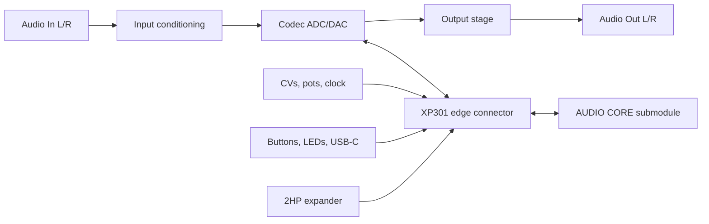

# b:ounce Carrier Board

Analog carrier PCB for **b:ounce**, a low-noise stereo multi-effect Eurorack module (8HP) by [b:art instruments](https://bartinstruments.com). The carrier handles everything analog: audio input and output conditioning, CV input scaling, controls, power entry and the USB-C service port. All digital processing lives on the **AUDIO CORE** submodule that plugs into this board.

> **Revision:** 1.2 (2026-11-26) | **Status:** production-ready schematics | **License:** CC-BY-NC-SA

## About b:ounce

b:ounce is an 8HP stereo effects processor with four effect modes:

| Mode | Panel corner | Description |
|------|--------------|-------------|
| Delay | Top left | Clean stereo delay with continuous FEEDBACK / CROSS-FEEDBACK blend (stereo to ping-pong) |
| Tape | Top right | Tape-style delay where time changes behave like tape speed changes |
| Reverb | Bottom left | Hall-leaning reverb that folds into a room at low SIZE and DECAY |
| Spectral | Bottom right | Spectral reverb that analyses the input spectrum and builds a slowly evolving texture |

The carrier is deliberately kept analog, simple and quiet, with audio routing isolated from CV, clock and power circuitry.

## Features of the carrier board

- Stereo audio inputs and outputs, through 3.5 mm Eurorack jacks.
- Dedicated analog input and output conditioning around the codec.
- Six main parameter knobs, each with a 0-5V CV expander output path, plus a dedicated DRY/WET knob with CV input.
- Two fine-control CV expander paths (FINE CV 1 and 2) for the first two parameters of the currently active mode.
- Clock input for tempo-synced delays.
- MODE and LINK/FREEZE buttons and four mode LEDs.
- 16-pin header for the optional 2HP expander (CV input for every main knob, plus two fine CVs).
- USB-C port for firmware updates and settings through the web configurator.
- M.2-style 75-pin edge connector (XP301) to the AUDIO CORE submodule, with an M.2 mounting nut.
- Onboard rails: +5V (buck converter, 1 A), +5VA, +3V3, +3.3VA and -2V5.
- Reverse-polarity and transient protection on the power inputs.

## Power

| Rail | Source | Use |
|------|--------|-----|
| +12V / -12V | Eurorack bus | Analog op-amp supplies |
| +5V | TPS54202 buck converter, 1 A | Digital supply and analog 5V |
| +5VA | Filtered +5V | Codec analog supply |
| +3V3 / +3.3VA | TLV70450 and filtering | Digital and analog 3.3V |
| -2V5 | Local reference | Bias and virtual-ground circuitry |

**Measured current draw with the AUDIO CORE submodule connected:** +89 mA from +12V and -24 mA from -12V.

## Architecture notes

All digital signals live on the AUDIO CORE submodule, which carries the microcontroller, memory and DSP workload. The carrier board provides the analog signal chain: input scaling, the stereo ADC/DAC and the differential output stage, with careful routing to isolate audio from CV, clock and power circuitry. A noise gate in the firmware further reduces residual noise before the effects.

## Repository contents

- KiCad project (`300-MULTIEFFECT-STM32H7.kicad_sch` and related files).
- PDF schematic export.

This repository contains no firmware. Firmware updates and settings are handled through the b:art instruments web configurator over USB-C.

## Configuration (web configurator)

Connect the module over USB-C and open the [configurator] (https://flash.bartinstruments.com/) in your browser. Current settings include:

- **Max delay time:** trade precision for range on the TIME knobs.
- **Triplets / Dotted notes:** clocked delay behavior.
- **Input normalisation:** send the left input to both channels when the right is unpatched.
- **Noise gate:** on/off, open and close thresholds, attack, hold and release times.

## License

Copyright applies to every part of this repository and to the product. Released under **CC-BY-NC-SA**. Commercial use requires permission.

For commercial inquiries: [bart@bartinstruments.com](mailto:bart@bartinstruments.com)